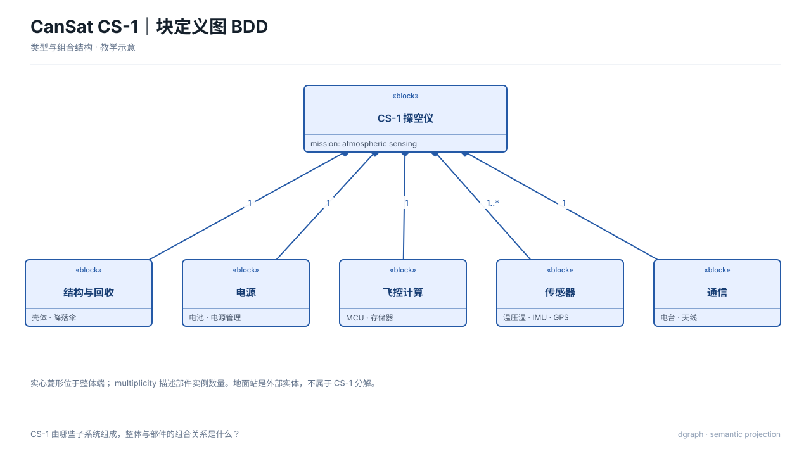
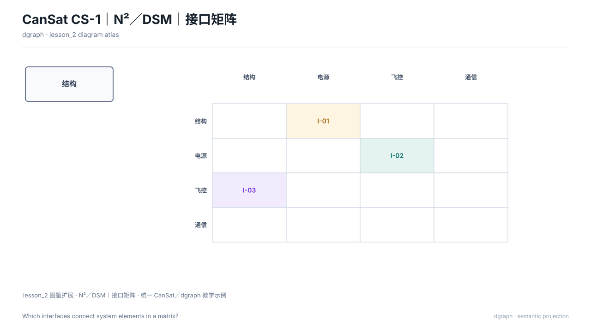
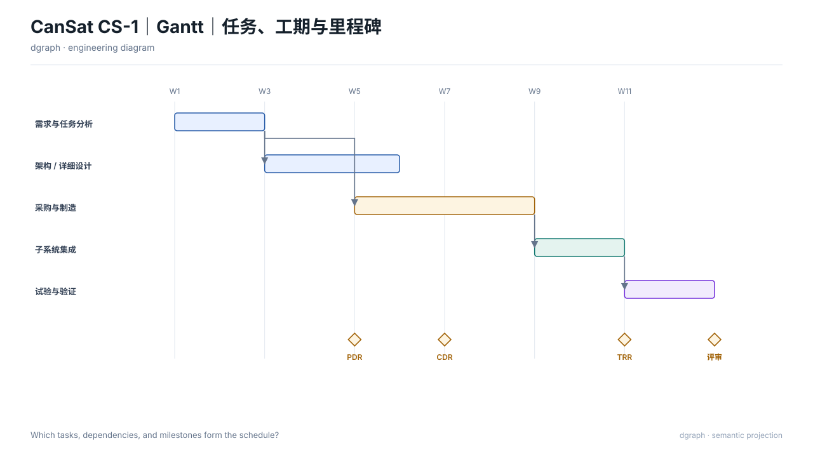
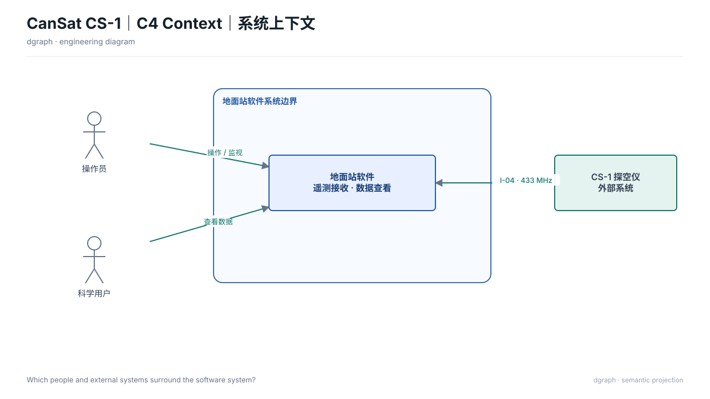
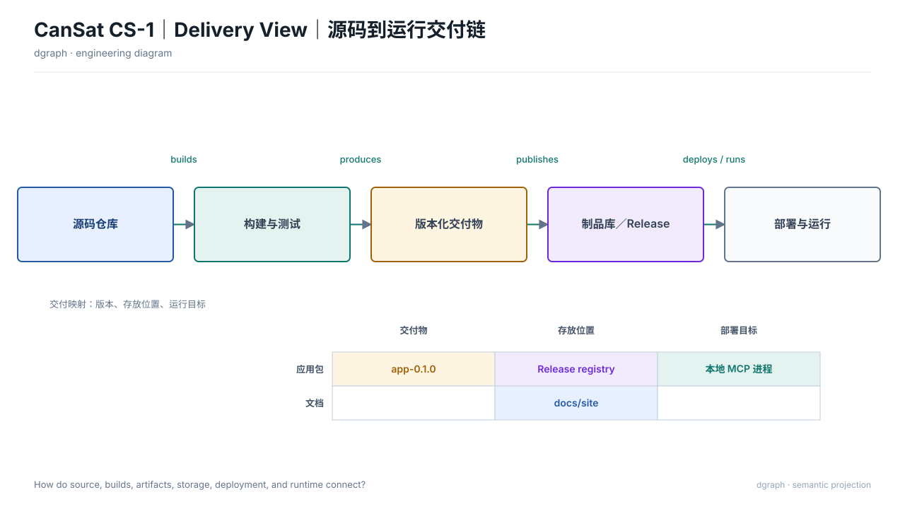

# dgraph

`dgraph` 是一个无内置模型的本地工程绘图 MCP。Kimi、Codex 或其他 MCP 客户端负责理解自然语言；dgraph 负责确定性的 ViewSpec 校验、SysML v2 编译、SVG 渲染和产物检查。

**没有 SysML 也可以直接绘图。**你可以只提供节点、关系、矩阵、图表或时间轴等语义输入。

## 快速开始

要求 Python 3.10+；随包 SysML 编译器适用于 Apple Silicon macOS。无需第三方 Python 包。

```bash
cd /absolute/path/to/dgraph
PYTHONPATH=. python3 -m dgraph
```

MCP 客户端配置示例（字段名以具体客户端为准）：

```json
{
  "mcpServers": {
    "dgraph": {
      "command": "python3",
      "args": ["-m", "dgraph"],
      "env": {"PYTHONPATH": "/absolute/path/to/dgraph"}
    }
  }
}
```

MCP 使用换行分隔的 JSON-RPC 消息。五个工具是：`list_diagram_types`、`analyze_sysml`、`validate_viewspec`、`render_diagram`、`inspect_diagram`。

## 输入方式 A：只有自然语言或结构化语义，没有 SysML

自然语言由客户端模型转换为 ViewSpec；dgraph 本身不内置模型。你也可以绕过模型，直接提交 JSON。

例如，对客户端说：

> 不使用 SysML。CS-1 是系统，科学用户是外部参与者，用户接收 CS-1 的遥测。画系统上下文图，突出系统边界。

对应的完整纯语义输入如下。`sources: []` 是合法值，不要求 `.sysml`，也不要求 Mermaid。

```json
{
  "schema": "diagram-view/v1",
  "type": "context",
  "intent": {"question": "系统边界在哪里？"},
  "sources": [],
  "selection": {
    "nodes": [
      {"id": "system", "label": "CS-1", "kind": "block", "x": 500, "y": 250, "w": 260, "h": 100, "sourceId": "demo.system"},
      {"id": "user", "label": "科学用户", "kind": "actor", "x": 100, "y": 250, "w": 100, "h": 100, "sourceId": "demo.user"}
    ],
    "edges": [
      {"source": "user", "target": "system", "kind": "association"}
    ]
  },
  "presentation": {"title": "CS-1 系统上下文"},
  "outputs": {"directory": "/absolute/output", "formats": ["viewspec", "dsl", "svg", "report"]}
}
```

- `intent.question` 决定图要回答的问题；
- `selection.nodes/edges` 提供有依据的语义；
- `sourceId` 保留来源标识；
- `x/y/w/h` 是当前版本的布局约束；
- `outputs.directory` 必须是绝对路径。

可直接运行的完整示例：[`examples/context/semantic/`](examples/context/semantic/README.md)。

### 通过 MCP 调用

下面是完整的 JSON-RPC `tools/call` 请求。把 `spec` 换成你的 ViewSpec 即可：

```json
{
  "jsonrpc": "2.0",
  "id": 1,
  "method": "tools/call",
  "params": {
    "name": "render_diagram",
    "arguments": {
      "spec": {
  "schema": "diagram-view/v1",
  "type": "context",
  "intent": {"question": "系统边界在哪里？"},
  "sources": [],
  "selection": {
    "nodes": [
      {"id": "system", "label": "CS-1", "kind": "block", "x": 500, "y": 250, "w": 260, "h": 100, "sourceId": "demo.system"},
      {"id": "user", "label": "科学用户", "kind": "actor", "x": 100, "y": 250, "w": 100, "h": 100, "sourceId": "demo.user"}
    ],
    "edges": [
      {"source": "user", "target": "system", "kind": "association"}
    ]
  },
  "presentation": {"title": "CS-1 系统上下文"},
  "outputs": {"directory": "/absolute/output", "formats": ["viewspec", "dsl", "svg", "report"]}
}
    }
  }
}
```

## 输入方式 B：已有 SysML v2 模型

SysML 模型回答“系统里有哪些事实”，当前用户意图回答“这次要说明什么问题”。已有 `view` 只作参考，不自动成为出图指令。

```text
.sysml 文件
  → analyze_sysml：冻结快照、parse、check、语义导出
  → 客户端按当前问题编写 ViewSpec
  → render_diagram：重新选择视图并渲染
```

`analyze_sysml` 输入示例：

```json
{
  "files": [
    {"name": "common.sysml", "content": "package Common { part def Power; }"},
    {"name": "model.sysml", "content": "package Model { import Common::*; part def System { part power : Power; } }"}
  ],
  "outputDir": "/absolute/output/sysml-analysis"
}
```

原文件不会被修改。编译通过只代表实际执行的语法和支持的语义检查通过，不等于视图选择正确或工程验证完成。完整两步示例：[`examples/block-definition/sysml/`](examples/block-definition/sysml/README.md)。

## 支持图类型

每个图种都有独立的 `semantic/` 指南、自然语言参考、`input.json`、`draw.py` 和 `output/`。只有明确列出 SysML 参考的图种提供 `.sysml` 示例；`—` 表示不需要或没有 SysML 参考。

### 五个示例

**块定义图 BDD**



**N²／DSM 接口矩阵**



**Gantt 任务计划**



**C4 Context 系统上下文**



**Delivery View 交付链**



表头为 **视图类型 / 调用方法 / SysML 参考 / 自然语言参考**。调用方法列中的工具均为 `render_diagram`。点击参考链接进入对应目录。

### SysML 与模型视图

| 视图类型 | 调用方法 | SysML 参考 | 自然语言参考 |
| --- | --- | --- | --- |
| 块定义图 BDD<br>`block-definition` | `render_diagram` | [SysML 参考](examples/block-definition/sysml/README.md) | [自然语言参考](examples/block-definition/semantic/README.md) |
| 内部块图 IBD<br>`internal-block` | `render_diagram` | [SysML 参考](examples/internal-block/sysml/README.md) | [自然语言参考](examples/internal-block/semantic/README.md) |
| 需求图<br>`requirements` | `render_diagram` | [SysML 参考](examples/requirements/sysml/README.md) | [自然语言参考](examples/requirements/semantic/README.md) |
| 参数图<br>`parametric` | `render_diagram` | [SysML 参考](examples/parametric/sysml/README.md) | [自然语言参考](examples/parametric/semantic/README.md) |
| 用例图<br>`use-case` | `render_diagram` | [SysML 参考](examples/use-case/sysml/README.md) | [自然语言参考](examples/use-case/semantic/README.md) |
| 活动图<br>`activity` | `render_diagram` | [SysML 参考](examples/activity/sysml/README.md) | [自然语言参考](examples/activity/semantic/README.md) |
| 序列图<br>`sequence` | `render_diagram` | [SysML 参考](examples/sequence/sysml/README.md) | [自然语言参考](examples/sequence/semantic/README.md) |
| 状态机图<br>`state-machine` | `render_diagram` | [SysML 参考](examples/state-machine/sysml/README.md) | [自然语言参考](examples/state-machine/semantic/README.md) |
| 包图<br>`package` | `render_diagram` | [SysML 参考](examples/package/sysml/README.md) | [自然语言参考](examples/package/semantic/README.md) |
| SysML v2｜View 与 Viewpoint<br>`sysml-v2` | `render_diagram` | [SysML 参考](examples/sysml-v2/sysml/README.md) | [自然语言参考](examples/sysml-v2/semantic/README.md) |

### OPM 与经典系统工程

| 视图类型 | 调用方法 | SysML 参考 | 自然语言参考 |
| --- | --- | --- | --- |
| OPM｜对象—过程对偶<br>`opm` | `render_diagram` | — | [自然语言参考](examples/opm/semantic/README.md) |
| C4 Model｜四个缩放层级<br>`c4` | `render_diagram` | — | [自然语言参考](examples/c4/semantic/README.md) |
| 经典 SE｜系统上下文图<br>`context` | `render_diagram` | — | [自然语言参考](examples/context/semantic/README.md) |
| FFBD｜功能流与分支<br>`ffbd` | `render_diagram` | — | [自然语言参考](examples/ffbd/semantic/README.md) |
| N²／DSM｜接口矩阵<br>`n2` | `render_diagram` | — | [自然语言参考](examples/n2/semantic/README.md) |
| IDEF0｜功能、输入、控制与机制<br>`idef0` | `render_diagram` | — | [自然语言参考](examples/idef0/semantic/README.md) |
| DFD｜数据流与存储<br>`dfd` | `render_diagram` | — | [自然语言参考](examples/dfd/semantic/README.md) |
| QFD 质量屋｜需求到工程特性<br>`qfd` | `render_diagram` | — | [自然语言参考](examples/qfd/semantic/README.md) |
| Tradespace／Pareto｜方案权衡<br>`tradespace` | `render_diagram` | — | [自然语言参考](examples/tradespace/semantic/README.md) |
| FTA｜故障树分析<br>`fta` | `render_diagram` | — | [自然语言参考](examples/fta/semantic/README.md) |
| CLD｜因果反馈回路<br>`cld` | `render_diagram` | — | [自然语言参考](examples/cld/semantic/README.md) |
| SFD｜存量与流量<br>`sfd` | `render_diagram` | — | [自然语言参考](examples/sfd/semantic/README.md) |

### 体系架构框架

| 视图类型 | 调用方法 | SysML 参考 | 自然语言参考 |
| --- | --- | --- | --- |
| DoDAF／UAF｜视点全景<br>`dodaf` | `render_diagram` | — | [自然语言参考](examples/dodaf/semantic/README.md) |
| DoDAF OV-1｜高级运行概念<br>`ov1` | `render_diagram` | — | [自然语言参考](examples/ov1/semantic/README.md) |
| DoDAF SV-1｜系统接口描述<br>`sv1` | `render_diagram` | — | [自然语言参考](examples/sv1/semantic/README.md) |
| DoDAF CV-2｜能力分类<br>`cv2` | `render_diagram` | — | [自然语言参考](examples/cv2/semantic/README.md) |
| ARCADIA｜五层工程分析<br>`arcadia` | `render_diagram` | — | [自然语言参考](examples/arcadia/semantic/README.md) |

### 项目管理

| 视图类型 | 调用方法 | SysML 参考 | 自然语言参考 |
| --- | --- | --- | --- |
| WBS｜工作分解<br>`wbs` | `render_diagram` | — | [自然语言参考](examples/wbs/semantic/README.md) |
| PBS｜产品分解<br>`pbs` | `render_diagram` | — | [自然语言参考](examples/pbs/semantic/README.md) |
| Gantt｜任务、工期与里程碑<br>`gantt` | `render_diagram` | — | [自然语言参考](examples/gantt/semantic/README.md) |
| PERT｜依赖与关键路径<br>`pert` | `render_diagram` | — | [自然语言参考](examples/pert/semantic/README.md) |
| 风险矩阵｜概率与影响<br>`risk-matrix` | `render_diagram` | — | [自然语言参考](examples/risk-matrix/semantic/README.md) |
| 燃尽图｜剩余工作趋势<br>`burndown` | `render_diagram` | — | [自然语言参考](examples/burndown/semantic/README.md) |

### UML 补充图

| 视图类型 | 调用方法 | SysML 参考 | 自然语言参考 |
| --- | --- | --- | --- |
| UML｜类图<br>`class` | `render_diagram` | — | [自然语言参考](examples/class/semantic/README.md) |
| UML｜对象图<br>`object` | `render_diagram` | — | [自然语言参考](examples/object/semantic/README.md) |
| UML｜组件与接口<br>`component` | `render_diagram` | — | [自然语言参考](examples/component/semantic/README.md) |
| UML｜组合结构图<br>`composite-structure` | `render_diagram` | — | [自然语言参考](examples/composite-structure/semantic/README.md) |
| UML｜部署图<br>`deployment` | `render_diagram` | — | [自然语言参考](examples/deployment/semantic/README.md) |
| UML｜剖面与构造型<br>`profile` | `render_diagram` | — | [自然语言参考](examples/profile/semantic/README.md) |
| UML｜通信图<br>`communication` | `render_diagram` | — | [自然语言参考](examples/communication/semantic/README.md) |
| UML｜交互概览图<br>`interaction-overview` | `render_diagram` | — | [自然语言参考](examples/interaction-overview/semantic/README.md) |
| UML｜时序图与时间约束<br>`timing` | `render_diagram` | — | [自然语言参考](examples/timing/semantic/README.md) |

### 软件、数据与运行

| 视图类型 | 调用方法 | SysML 参考 | 自然语言参考 |
| --- | --- | --- | --- |
| 事件风暴｜业务事件链<br>`event-storming` | `render_diagram` | — | [自然语言参考](examples/event-storming/semantic/README.md) |
| 影响地图｜目标到交付<br>`impact-map` | `render_diagram` | — | [自然语言参考](examples/impact-map/semantic/README.md) |
| 模块依赖｜代码结构<br>`module-dependency` | `render_diagram` | — | [自然语言参考](examples/module-dependency/semantic/README.md) |
| 类层次｜继承结构<br>`class-hierarchy` | `render_diagram` | — | [自然语言参考](examples/class-hierarchy/semantic/README.md) |
| ETA｜事件树分析<br>`eta` | `render_diagram` | — | [自然语言参考](examples/eta/semantic/README.md) |
| 看板｜工作流与在制品<br>`kanban` | `render_diagram` | — | [自然语言参考](examples/kanban/semantic/README.md) |
| BPMN｜业务流程<br>`bpmn` | `render_diagram` | — | [自然语言参考](examples/bpmn/semantic/README.md) |
| ArchiMate｜业务—应用—技术<br>`archimate` | `render_diagram` | — | [自然语言参考](examples/archimate/semantic/README.md) |
| CI/CD｜构建、关口与发布<br>`cicd` | `render_diagram` | — | [自然语言参考](examples/cicd/semantic/README.md) |
| 部署拓扑｜节点与网络<br>`deployment-topology` | `render_diagram` | — | [自然语言参考](examples/deployment-topology/semantic/README.md) |
| 火焰图｜栈帧耗时<br>`flame-graph` | `render_diagram` | — | [自然语言参考](examples/flame-graph/semantic/README.md) |
| 调用图｜函数关系<br>`call-graph` | `render_diagram` | — | [自然语言参考](examples/call-graph/semantic/README.md) |
| 用户故事地图｜活动与发布<br>`story-map` | `render_diagram` | — | [自然语言参考](examples/story-map/semantic/README.md) |
| DDD｜限界上下文映射<br>`ddd-context-map` | `render_diagram` | — | [自然语言参考](examples/ddd-context-map/semantic/README.md) |
| DMN｜决策规则表<br>`dmn` | `render_diagram` | — | [自然语言参考](examples/dmn/semantic/README.md) |
| ER｜实体与关系<br>`er` | `render_diagram` | — | [自然语言参考](examples/er/semantic/README.md) |
| C4 Context｜系统上下文<br>`c4-context` | `render_diagram` | — | [自然语言参考](examples/c4-context/semantic/README.md) |
| C4 Container｜可部署容器<br>`c4-container` | `render_diagram` | — | [自然语言参考](examples/c4-container/semantic/README.md) |

### 交付与维护

| 视图类型 | 调用方法 | SysML 参考 | 自然语言参考 |
| --- | --- | --- | --- |
| Delivery View｜源码到运行交付链<br>`delivery` | `render_diagram` | — | [自然语言参考](examples/delivery/semantic/README.md) |

## 安全与验证契约

ViewSpec 使用版本化的 `diagram-view/v1` Schema。MCP 的 `dgraph://schema/<type>` 资源返回该图种的 JSON Schema；运行时仍会执行 Schema 无法表达的图种语义、ID 唯一性、引用完整性、坐标边界和领域不变量检查。未知字段会被拒绝，以免拼写错误被静默忽略。节点和边可用 `authority` 标记为 `fact`、`view` 或 `inferred`，报告会汇总已声明与未声明来源。

当前公共输入上限：

- 最多 500 个节点、2,000 条边、250 个分组和 500 条注释；
- 文本字段最长 4,096 字符，标签和问题字段另有字段级长度限制；
- `analyze_sysml` 最多接受 128 个文件、单文件 5 MiB、总计 10 MiB；
- 所有坐标和尺寸必须是有限数值，节点必须位于画布内，尺寸必须大于零。

`outputs.directory` 必须是绝对路径。服务会拒绝文件系统根目录、用户主目录和项目根目录；部署时还可设置 `DGRAPH_OUTPUT_ROOT=/allowed/root`，把所有产物限制在指定目录树内。`analyze_sysml` 和 `render_diagram` 先在隔离暂存目录生成完整结果，再在输出锁保护下替换产物；提交失败会回滚，避免 SVG、报告和 manifest 来自不同批次。

MCP 工具错误返回稳定的 `code`、`phase`、`field`、`path`、`relatedIds`、`suggestion` 和 `retryable` 字段。例如，悬空边返回 `dangling-edge`，并给出具体的 `selection.edges[n]` 路径。`analyze_sysml` 的非法模型会返回 `ok: false`、`status: invalid-model` 和结构化诊断。

SVG 检查覆盖文本和节点越界、节点重叠、重复节点 ID 和来源标识缺失。`report.json` 记录 Schema、语义和 SVG 检查结果，`manifest.json` 对当前批次全部核心产物做 SHA-256 校验。

随包 SysML 编译器是 `aarch64-apple-darwin` 二进制，并作为包数据进入 wheel；构建出的 wheel 标记为 `macosx_11_0_arm64`，避免被不兼容平台误装。不兼容主机会明确返回 `compiler-unavailable`；不会以 `Exec format error` 中断 MCP 服务。

## 测试

项目不依赖第三方 Python 测试框架：

```bash
PYTHONPATH=. python3 -m unittest discover -s tests -v
```

CI 在 Python 3.10–3.12 上运行完整非原生测试。依赖随包编译器的 SysML 集成测试仅在匹配的 Apple Silicon 主机执行，其他平台明确跳过。
