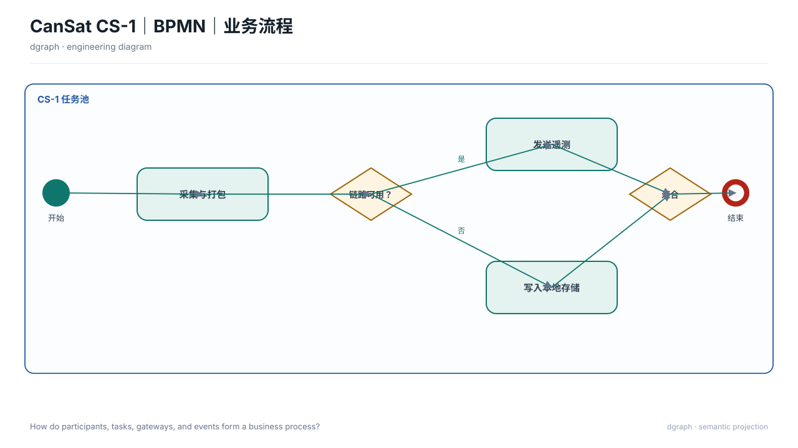

# BPMN｜业务流程（`bpmn`）

## 图种与用途

本图回答：**参与者、任务、网关和事件如何形成业务流程？**

适用于需要把这一问题讲清楚的评审、设计或维护场景。不要把它当作通用装饰图；问题改变时，应重新选择图种或视图。

## 示例图



## 自然语言输入示例

不使用 SysML，只根据以下语义画一张BPMN｜业务流程，回答“参与者、任务、网关和事件如何形成业务流程？”

以 `selection.bpmnModel` 为图的语义模型：
- pool：地面站遥测处理。
- lanes：telemetry（遥测服务
接收 · 质控 · 归档）（y=180；height=205）。
- lanes：science（科学分析
查看 · 分析）（y=385；height=215）。
- events：start（帧到达）（kind="start"；lane="telemetry"；x=228；y=247）。
- events：abnormal-end（终止）（kind="end"；lane="telemetry"；x=1060；y=337）。
- events：end（完成）（kind="end"；lane="science"；x=1150；y=477）。
- tasks：receive（接收并解码帧）（lane="telemetry"；x=290；y=205）。
- tasks：archive（入库）（lane="telemetry"；x=730；y=205）。
- tasks：reject（标记异常）（lane="telemetry"；x=730；y=295）。
- tasks：analyze（查看与分析）（lane="science"；x=840；y=435）。
- gateways：quality（质控合格？）（lane="telemetry"；x=520；y=205）。
- flows：start → receive（source="start"；target="receive"；points=[[250, 247], [290, 247]]）。
- flows：receive → quality（source="receive"；target="quality"；points=[[500, 247], [520, 247]]）。
- flows：合格（source="quality"；target="archive"；points=[[650, 247], [730, 247]]）。
- flows：不合格（source="quality"；target="reject"；branch="unavailable"；points=[[585, 289], [585, 337], [730, 337]]）。
- flows：reject → abnormal-end（source="reject"；target="abnormal-end"；points=[[940, 337], [1038, 337]]）。
- flows：archive → analyze（source="archive"；target="analyze"；points=[[940, 247], [985, 247], [985, 410], [945, 410], [945, 435]]）。
- flows：analyze → end（source="analyze"；target="end"；points=[[1050, 477], [1128, 477]]）。

保持来源标识，缺少依据的关系不要补充。

## 输入文件与语义说明

`input.json` 是纯语义 ViewSpec，本例不需要 `.sysml`。

- `intent.question`：本图回答的问题；
- `selection.bpmnModel`：本图权威语义，包含领域对象、数值与关系；
- `selection.nodes/edges`：仅供通用图使用，不能替代上述专用模型；
- `selection.matrices/charts/timelines`：该图种需要时使用的专用原语；
- `x/y/w/h`：当前版本的布局约束；
- `outputs.directory`：由 `draw.py` 自动改为本目录的 `output/`。

示例语义标签：接收并解码帧、入库、标记异常、查看与分析。完整输入见 `input.json`。

## 如何运行

从 dgraph 根目录执行：

```bash
PYTHONPATH=. python3 examples/bpmn/semantic/draw.py
```

脚本只调用公共 API，不绕过渲染器，也不直接手写 SVG。

## 输出文件

```text
output/
├── diagram.svg        # 最终图
├── view.yaml          # 实际执行的 ViewSpec
├── diagram.dsl.yaml   # 图形语义与布局
├── report.json        # 校验与检查结果
└── manifest.json      # 输入与产物哈希
```

部分图种另有 `diagram.mmd`；SysML 示例另有 `output/sysml-analysis/`。

## 如何改成自己的图

1. 修改 `selection.bpmnModel` 中的对象、数值与关系，保持内部 ID 引用一致；
2. 增加对象时同步补充有依据的关系，不编造事实；
3. 调整对应图元或布局约束后重新运行，不直接编辑 `output/diagram.svg`。

## 当前边界与常见问题

**没有 SysML 可以吗？** 可以，`semantic/` 示例就是纯语义输入。

**必须写 Mermaid 吗？** 不需要。Mermaid 只是部分图种的可选导出，SVG 与 YAML DSL 才是完整产物。

**这是任意规模的自动布局吗？** 不是。本例验证图种渲染；复杂项目仍需减少元素并做最终视觉复核。
