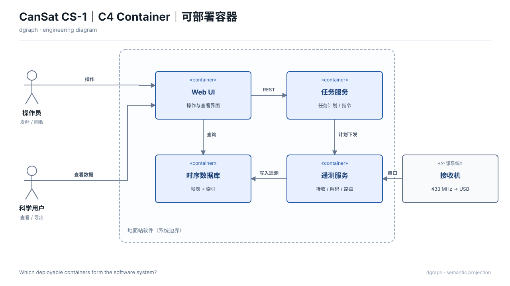

# C4 Container｜可部署容器（`c4-container`）

## 图种与用途

本图回答：**系统由哪些可部署容器组成？**

适用于需要把这一问题讲清楚的评审、设计或维护场景。不要把它当作通用装饰图；问题改变时，应重新选择图种或视图。

## 示例图



## 自然语言输入示例

不使用 SysML，只根据以下语义画一张C4 Container｜可部署容器，回答“系统由哪些可部署容器组成？”

以 `selection.c4Container` 为图的语义模型：
- boundary：id="ground-station"；label="地面站软件"。
- actors：operator（操作员）（note="发射 / 回收"；x=80；y=190）。
- actors：scientist（科学用户）（note="查看 / 导出"；x=80；y=430）。
- containers：web-ui（Web UI）（note="操作与查看界面"；x=390；y=180）。
- containers：mission-service（任务服务）（note="任务计划 / 指令"；x=720；y=180）。
- containers：timeseries-db（时序数据库）（note="帧表 + 索引"；x=390；y=390）。
- containers：telemetry-service（遥测服务）（note="接收 / 解码 / 路由"；x=720；y=390）。
- containers：receiver（接收机）（note="433 MHz → USB"；x=1010；y=390；external=true）。
- relations：操作（source="operator"；target="web-ui"；points=[[100, 214], [350, 214], [350, 215], [390, 215]]）。
- relations：查看数据（source="scientist"；target="web-ui"；points=[[100, 454], [320, 454], [320, 265], [390, 265]]）。
- relations：REST（source="web-ui"；target="mission-service"；points=[[630, 240], [720, 240]]）。
- relations：查询（source="web-ui"；target="timeseries-db"；points=[[510, 300], [510, 390]]）。
- relations：计划下发（source="mission-service"；target="telemetry-service"；points=[[840, 300], [840, 390]]）。
- relations：串口（source="receiver"；target="telemetry-service"；points=[[1010, 450], [960, 450]]）。
- relations：写入遥测（source="telemetry-service"；target="timeseries-db"；points=[[720, 450], [630, 450]]）。

保持来源标识，缺少依据的关系不要补充。

## 输入文件与语义说明

`input.json` 是纯语义 ViewSpec，本例不需要 `.sysml`。

- `intent.question`：本图回答的问题；
- `selection.c4Container`：本图权威语义，包含领域对象、数值与关系；
- `selection.nodes/edges`：仅供通用图使用，不能替代上述专用模型；
- `selection.matrices/charts/timelines`：该图种需要时使用的专用原语；
- `x/y/w/h`：当前版本的布局约束；
- `outputs.directory`：由 `draw.py` 自动改为本目录的 `output/`。

示例语义标签：Web UI、任务服务、时序数据库、遥测服务、接收机。完整输入见 `input.json`。

## 如何运行

从 dgraph 根目录执行：

```bash
PYTHONPATH=. python3 examples/c4-container/semantic/draw.py
```

脚本只调用公共 API，不绕过渲染器，也不直接手写 SVG。

## 输出文件

```text
output/
├── diagram.svg        # 最终图
├── view.yaml          # 实际执行的 ViewSpec
├── diagram.dsl.yaml   # 图形语义与布局
├── report.json        # 校验与检查结果
└── manifest.json      # 输入与产物哈希
```

部分图种另有 `diagram.mmd`；SysML 示例另有 `output/sysml-analysis/`。

## 如何改成自己的图

1. 修改 `selection.c4Container` 中的对象、数值与关系，保持内部 ID 引用一致；
2. 增加对象时同步补充有依据的关系，不编造事实；
3. 调整对应图元或布局约束后重新运行，不直接编辑 `output/diagram.svg`。

## 当前边界与常见问题

**没有 SysML 可以吗？** 可以，`semantic/` 示例就是纯语义输入。

**必须写 Mermaid 吗？** 不需要。Mermaid 只是部分图种的可选导出，SVG 与 YAML DSL 才是完整产物。

**这是任意规模的自动布局吗？** 不是。本例验证图种渲染；复杂项目仍需减少元素并做最终视觉复核。
