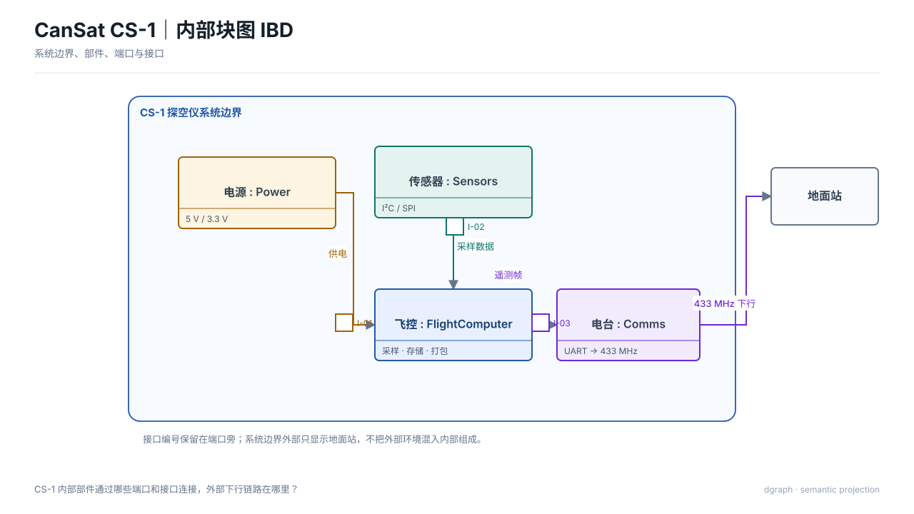

# 内部块图 IBD（`internal-block`）

## 图种与用途

本图回答：**内部部件、端口与接口如何连接？**

适用于需要把这一问题讲清楚的评审、设计或维护场景。不要把它当作通用装饰图；问题改变时，应重新选择图种或视图。

## 示例图



## 自然语言输入示例

读取 `model.sysml`，结合“内部部件、端口与接口如何连接？”重新选择视图元素，不自动采用模型已有的 view，然后绘制内部块图 IBD。

## 输入文件与语义说明

`model.sysml` 提供模型事实，`input.json` 选择本次视图；两者职责不同。

- `intent.question`：本图回答的问题；
- `selection.nodes`：图上的对象，保留 `sourceId` 来源标识；
- `selection.edges`：有依据的关系；
- `selection.matrices/charts/timelines`：该图种需要时使用的专用原语；
- `x/y/w/h`：当前版本的布局约束；
- `outputs.directory`：由 `draw.py` 自动改为本目录的 `output/`。

示例语义标签：电源 : Power、传感器 : Sensors、飞控 : FlightComputer、电台 : Comms。完整输入见 `input.json`。

## 模型与视图的关系

- `model.sysml` 只提供系统事实，原文件只读；
- `input.json` 决定本次要回答的问题和选择的元素；
- 不自动继承模型已有的 `view`；
- 先运行 `analyze_sysml`，成功后再运行 `render_diagram`；编译通过不等于视图选择或工程验证正确。

## 如何运行

从 dgraph 根目录执行：

```bash
PYTHONPATH=. python3 examples/internal-block/sysml/draw.py
```

脚本只调用公共 API，不绕过渲染器，也不直接手写 SVG。

## 输出文件

```text
output/
├── diagram.svg        # 最终图
├── view.yaml          # 实际执行的 ViewSpec
├── diagram.dsl.yaml   # 图形语义与布局
├── report.json        # 校验与检查结果
└── manifest.json      # 输入与产物哈希
```

部分图种另有 `diagram.mmd`；SysML 示例另有 `output/sysml-analysis/`。

## 如何改成自己的图

1. 修改节点 `label` 和稳定 `sourceId`，换成自己的对象；
2. 增加对象时同步补充有依据的关系，不编造事实；
3. 调整对应图元或布局约束后重新运行，不直接编辑 `output/diagram.svg`。

## 当前边界与常见问题

**没有 SysML 可以吗？** 可以，`semantic/` 示例就是纯语义输入。

**必须写 Mermaid 吗？** 不需要。Mermaid 只是部分图种的可选导出，SVG 与 YAML DSL 才是完整产物。

**这是任意规模的自动布局吗？** 不是。本例验证图种渲染；复杂项目仍需减少元素并做最终视觉复核。
