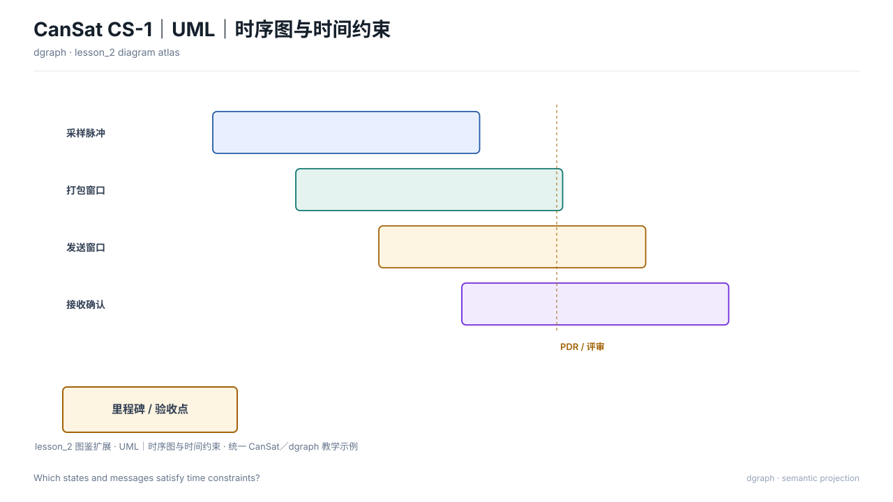

# UML｜时序图与时间约束（`timing`）

## 图种与用途

本图回答：**状态和消息如何满足时间约束？**

适用于需要把这一问题讲清楚的评审、设计或维护场景。不要把它当作通用装饰图；问题改变时，应重新选择图种或视图。

## 示例图



## 自然语言输入示例

不使用 SysML，只根据以下语义画一张UML｜时序图与时间约束，回答“状态和消息如何满足时间约束？”

以 `selection.timingModel` 为图的语义模型：
- durationMs：2000。
- ticks：0、500、1000、1500、2000。
- lifelines：sensor（传感器）（segments=[{"from": 0, "to": 80, "state": "采样"}, {"from": 80, "to": 1000, "state": "等待"}, {"from": 1000, "to": 1080, "state": "采样"}, {"from": 1080, "to": 2000, "state": "等待"}]）。
- lifelines：ground（地面站）（segments=[{"from": 0, "to": 130, "state": "等待"}, {"from": 130, "to": 230, "state": "处理"}, {"from": 230, "to": 1130, "state": "等待"}, {"from": 1130, "to": 1230, "state": "处理"}, {"from": 1230, "to": 2000, "state": "等待"}]）。
- lifelines：radio（电台）（segments=[{"from": 0, "to": 80, "state": "空闲"}, {"from": 80, "to": 130, "state": "发送"}, {"from": 130, "to": 1080, "state": "空闲"}, {"from": 1080, "to": 1130, "state": "发送"}, {"from": 1130, "to": 2000, "state": "空闲"}]）。
- constraints：采样周期 T = 1000 ms（from=0；to=1000）。
- constraints：发送 ≤ 50 ms（from=80；to=130）。
- constraints：处理 ≤ 100 ms（from=130；to=230）。

保持来源标识，缺少依据的关系不要补充。

## 输入文件与语义说明

`input.json` 是纯语义 ViewSpec，本例不需要 `.sysml`。

- `intent.question`：本图回答的问题；
- `selection.timingModel`：本图权威语义，包含领域对象、数值与关系；
- `selection.nodes/edges`：仅供通用图使用，不能替代上述专用模型；
- `selection.matrices/charts/timelines`：该图种需要时使用的专用原语；
- `x/y/w/h`：当前版本的布局约束；
- `outputs.directory`：由 `draw.py` 自动改为本目录的 `output/`。

示例语义标签：传感器、地面站、电台。完整输入见 `input.json`。

## 如何运行

从 dgraph 根目录执行：

```bash
PYTHONPATH=. python3 examples/timing/semantic/draw.py
```

脚本只调用公共 API，不绕过渲染器，也不直接手写 SVG。

## 输出文件

```text
output/
├── diagram.svg        # 最终图
├── view.yaml          # 实际执行的 ViewSpec
├── diagram.dsl.yaml   # 图形语义与布局
├── report.json        # 校验与检查结果
└── manifest.json      # 输入与产物哈希
```

部分图种另有 `diagram.mmd`；SysML 示例另有 `output/sysml-analysis/`。

## 如何改成自己的图

1. 修改 `selection.timingModel` 中的对象、数值与关系，保持内部 ID 引用一致；
2. 增加对象时同步补充有依据的关系，不编造事实；
3. 调整对应图元或布局约束后重新运行，不直接编辑 `output/diagram.svg`。

## 当前边界与常见问题

**没有 SysML 可以吗？** 可以，`semantic/` 示例就是纯语义输入。

**必须写 Mermaid 吗？** 不需要。Mermaid 只是部分图种的可选导出，SVG 与 YAML DSL 才是完整产物。

**这是任意规模的自动布局吗？** 不是。本例验证图种渲染；复杂项目仍需减少元素并做最终视觉复核。
