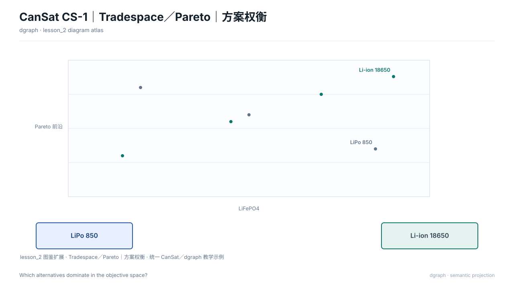

# Tradespace／Pareto｜方案权衡（`tradespace`）

## 图种与用途

本图回答：**哪些方案位于目标空间的 Pareto 前沿？**

适用于需要把这一问题讲清楚的评审、设计或维护场景。不要把它当作通用装饰图；问题改变时，应重新选择图种或视图。

## 示例图



## 自然语言输入示例

不使用 SysML，只根据以下语义画一张Tradespace／Pareto｜方案权衡，回答“哪些方案位于目标空间的 Pareto 前沿？”

以 `selection.tradespaceModel` 为图的语义模型：
- x：label="电池质量（g）"；min=0；max=180。
- y：label="可用能量（Wh）"；min=0；max=25。
- thresholds：maxX=120；minY=10。
- alternatives：lipo450（LiPo 2S 450）（x=28；y=3.3；cost=55）。
- alternatives：lipo850（LiPo 2S 850）（x=48；y=6.3；cost=85；labelDx=-112；labelDy=-16）。
- alternatives：lifepo（LiFePO4 2S 700）（x=52；y=4.5；cost=110）。
- alternatives：lipo1000（LiPo 2S 1000）（x=56；y=7.4；cost=95；labelDx=12；labelDy=-4）。
- alternatives：lipo3s（LiPo 3S 850）（x=66；y=9.4；cost=110；labelDx=12；labelDy=-12）。
- alternatives：liion18650（Li-ion 2S 18650）（x=94；y=15.8；cost=120）。
- alternatives：liion21700（Li-ion 2S 21700）（x=140；y=21.6；cost=180）。
- alternatives：nimh（NiMH 2S）（x=110；y=7.2；cost=70）。
- paretoIds：lipo450、lipo850、lipo1000、lipo3s、liion18650、liion21700。

保持来源标识，缺少依据的关系不要补充。

## 输入文件与语义说明

`input.json` 是纯语义 ViewSpec，本例不需要 `.sysml`。

- `intent.question`：本图回答的问题；
- `selection.tradespaceModel`：本图权威语义，包含领域对象、数值与关系；
- `selection.nodes/edges`：仅供通用图使用，不能替代上述专用模型；
- `selection.matrices/charts/timelines`：该图种需要时使用的专用原语；
- `x/y/w/h`：当前版本的布局约束；
- `outputs.directory`：由 `draw.py` 自动改为本目录的 `output/`。

示例语义标签：LiPo 2S 450、LiPo 2S 850、LiFePO4 2S 700、LiPo 2S 1000、LiPo 3S 850、Li-ion 2S 18650、Li-ion 2S 21700、NiMH 2S。完整输入见 `input.json`。

## 如何运行

从 dgraph 根目录执行：

```bash
PYTHONPATH=. python3 examples/tradespace/semantic/draw.py
```

脚本只调用公共 API，不绕过渲染器，也不直接手写 SVG。

## 输出文件

```text
output/
├── diagram.svg        # 最终图
├── view.yaml          # 实际执行的 ViewSpec
├── diagram.dsl.yaml   # 图形语义与布局
├── report.json        # 校验与检查结果
└── manifest.json      # 输入与产物哈希
```

部分图种另有 `diagram.mmd`；SysML 示例另有 `output/sysml-analysis/`。

## 如何改成自己的图

1. 修改 `selection.tradespaceModel` 中的对象、数值与关系，保持内部 ID 引用一致；
2. 增加对象时同步补充有依据的关系，不编造事实；
3. 调整对应图元或布局约束后重新运行，不直接编辑 `output/diagram.svg`。

## 当前边界与常见问题

**没有 SysML 可以吗？** 可以，`semantic/` 示例就是纯语义输入。

**必须写 Mermaid 吗？** 不需要。Mermaid 只是部分图种的可选导出，SVG 与 YAML DSL 才是完整产物。

**这是任意规模的自动布局吗？** 不是。本例验证图种渲染；复杂项目仍需减少元素并做最终视觉复核。
