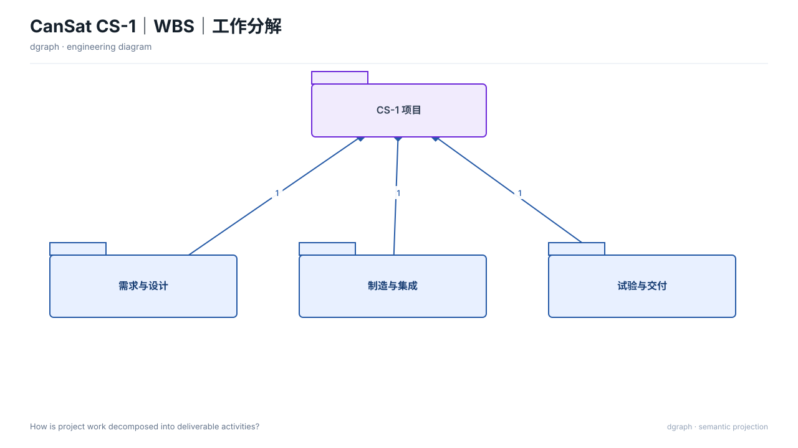

# WBS｜工作分解（`wbs`）

## 图种与用途

本图回答：**项目工作如何分解为可管理活动？**

适用于需要把这一问题讲清楚的评审、设计或维护场景。不要把它当作通用装饰图；问题改变时，应重新选择图种或视图。

## 示例图



## 自然语言输入示例

不使用 SysML，只根据以下语义画一张WBS｜工作分解，回答“项目工作如何分解为可管理活动？”

图上的对象：
- n0：CS-1 研制项目（来源 Example.pm-wbs.n0）。
- n1：1.1 需求分析（来源 Example.pm-wbs.n1）。
- n6：1.1.1 任务书（来源 Example.pm-wbs.n6）。
- n11：1.1.2 需求基线（来源 Example.pm-wbs.n11）。
- n2：1.2 设计（来源 Example.pm-wbs.n2）。
- n7：1.2.1 架构设计（来源 Example.pm-wbs.n7）。
- n12：1.2.2 详细设计（来源 Example.pm-wbs.n12）。
- n3：1.3 采购制造（来源 Example.pm-wbs.n3）。
- n8：1.3.1 器材采购（来源 Example.pm-wbs.n8）。
- n13：1.3.2 结构加工（来源 Example.pm-wbs.n13）。
- n4：1.4 集成（来源 Example.pm-wbs.n4）。
- n9：1.4.1 系统集成（来源 Example.pm-wbs.n9）。
- n14：1.4.2 总装联调（来源 Example.pm-wbs.n14）。
- n5：1.5 试验评审（来源 Example.pm-wbs.n5）。
- n10：1.5.1 环境试验（来源 Example.pm-wbs.n10）。
- n15：1.5.2 飞行试验（来源 Example.pm-wbs.n15）。
有依据的关系：
- n0 → n1：association 。
- n1 → n6：association 。
- n1 → n11：association 。
- n0 → n2：association 。
- n2 → n7：association 。
- n2 → n12：association 。
- n0 → n3：association 。
- n3 → n8：association 。
- n3 → n13：association 。
- n0 → n4：association 。
- n4 → n9：association 。
- n4 → n14：association 。
- n0 → n5：association 。
- n5 → n10：association 。
- n5 → n15：association 。

保持来源标识，缺少依据的关系不要补充。

## 输入文件与语义说明

`input.json` 是纯语义 ViewSpec，本例不需要 `.sysml`。

- `intent.question`：本图回答的问题；
- `selection.nodes`：图上的对象，保留 `sourceId` 来源标识；
- `selection.edges`：有依据的关系；
- `selection.matrices/charts/timelines`：该图种需要时使用的专用原语；
- `x/y/w/h`：当前版本的布局约束；
- `outputs.directory`：由 `draw.py` 自动改为本目录的 `output/`。

示例语义标签：CS-1 研制项目、1.1 需求分析、1.1.1 任务书、1.1.2 需求基线、1.2 设计、1.2.1 架构设计、1.2.2 详细设计、1.3 采购制造、1.3.1 器材采购、1.3.2 结构加工、1.4 集成、1.4.1 系统集成、1.4.2 总装联调、1.5 试验评审、1.5.1 环境试验、1.5.2 飞行试验。完整输入见 `input.json`。

## 如何运行

从 dgraph 根目录执行：

```bash
PYTHONPATH=. python3 examples/wbs/semantic/draw.py
```

脚本只调用公共 API，不绕过渲染器，也不直接手写 SVG。

## 输出文件

```text
output/
├── diagram.svg        # 最终图
├── view.yaml          # 实际执行的 ViewSpec
├── diagram.dsl.yaml   # 图形语义与布局
├── report.json        # 校验与检查结果
└── manifest.json      # 输入与产物哈希
```

部分图种另有 `diagram.mmd`；SysML 示例另有 `output/sysml-analysis/`。

## 如何改成自己的图

1. 修改节点 `label` 和稳定 `sourceId`，换成自己的对象；
2. 增加对象时同步补充有依据的关系，不编造事实；
3. 调整对应图元或布局约束后重新运行，不直接编辑 `output/diagram.svg`。

## 当前边界与常见问题

**没有 SysML 可以吗？** 可以，`semantic/` 示例就是纯语义输入。

**必须写 Mermaid 吗？** 不需要。Mermaid 只是部分图种的可选导出，SVG 与 YAML DSL 才是完整产物。

**这是任意规模的自动布局吗？** 不是。本例验证图种渲染；复杂项目仍需减少元素并做最终视觉复核。
